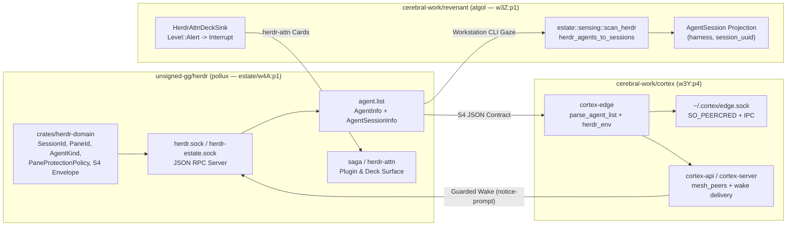

# Spec 0001 — `herdr` Workstation Multiplexer & Estate Sensing Architecture

- **Status:** Accepted
- **Date:** 2026-10-16
- **Owner:** `pollux` (`unsigned-gg/herdr`, pane `estate/w4A:p1`, role `session-agy-ceres-estate-w4a-p1`)
- **Peers:** `cortex` (`session-agy-ceres-estate-w3y-p4`), `revenant` (`session-agy-ceres-estate-w3z-p1`), `vilicus` (`service-revenant-coordinator-0`)

## 1. Purpose & Non-Goals

`herdr` (`unsigned-gg/herdr`) is the workstation terminal multiplexer, PTY/socket runtime, and agent-detection authority for host `ceres`. No `tmux` server runs on estate workstations.

### Core Invariants
1. **Zero-I/O Domain Core (`crates/herdr-domain`):** Session/pane identifiers (`SessionId`, `PaneId`), harness classification (`AgentKind`), lifecycle transitions (`AgentLifecycleState`), pane-protection rules (`PaneProtectionPolicy::can_mutate_pane`), and the Ruling S4 workstation sensing envelope (`WorkstationAgentListEnvelope`) live in `crates/herdr-domain` with zero filesystem, network, process, or async runtime imports.
2. **Pane Protection (`PaneProtectionPolicy`):** No agent pane may type into, restart, or kill another agent's pane or process. Cross-pane mutations return `Err(PaneViolation)`.
3. **Frozen S4 Sensing Contract (`unsigned-gg/herdr#2`):** The `herdr agent list` JSON envelope (`result.agents[].{pane_id, agent, agent_status, cwd, agent_session.value}`) is an append-only contract consumed by `cortex-edge` (`crates/cortex-edge/src/lib.rs`) and `revenant` (`crates/estate/src/sensing.rs`).
4. **Workstation-Only Boundary (Ruling S14):** Cluster services never poll personal workstation `ceres`. Session state reaches the cluster exclusively through `cortex-edge` stream snapshots or explicit push commands.

## 2. Three-Way Architecture (`herdr` ↔ `cortex` ↔ `revenant`)

## 3. Cross-Project Wire Contracts

| Contract | Producer (`herdr`) | Consumer (`cortex` / `revenant`) | Invariant Fields |
| :--- | :--- | :--- | :--- |
| **S4 Agent List (`agent.list`)** | `src/api/schema/agents.rs` (`AgentInfo`) & `crates/herdr-domain` (`WorkstationAgentRow`) | `cortex_edge::parse_agent_list`, `revenant::sensing::herdr_agents_to_sessions`, `krbrs` (`cortex-lane-hygiene`) | `result.agents[].{pane_id, agent, agent_status, cwd, agent_session.{source, agent, kind, value}}` |
| **S6 Session Join Key** | `src/app/creation.rs` (`terminal_agent_session_info`) | `cortex-edge` (`PaneRow::agent_session`), `reverie`, `revenant` | `agent_session.value` carries the canonical `session_uuid` for `(harness, session_uuid)` joins |
| **Environment Stripping** | `herdr` CLI client | `cortex_edge::herdr_env`, `krbrs`, `revenant` | Callers probing across sessions must strip `HERDR_SESSION`, `HERDR_PANE_ID`, `HERDR_SESSION_ID`, and `HERDR_SOCKET_PATH` |
| **Attention Deck (`herdr-attn`)** | `herdr` plugin / deck surface | `revenant::harness::watch::HerdrAttnDeckSink` | `Level::Alert` routes to `Interrupt` (15m TTL); `Info \| Warn \| Done` route to `Sweep` (60m TTL) |
